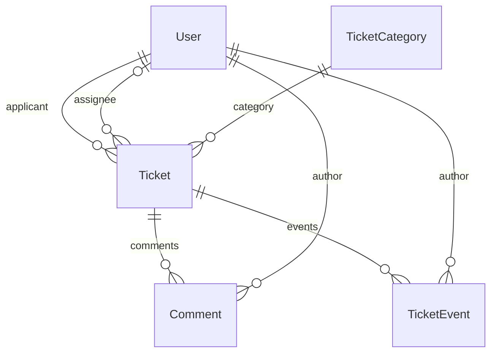

# Учёт обращений

Django REST API. Заявитель создаёт обращения и видит свои, исполнитель видит назначенные, администратор видит все и назначает исполнителей. Статусы: new → in_progress → closed. Только администратор может отдельно переоткрыть закрытое обращение. Просрочено: новое обращение с прошедшим сроком реакции.

## Запуск Windows

В PowerShell из папки проекта:

```powershell
py -3.13 -m venv .venv
.\.venv\Scripts\python.exe -m pip install -r requirements.txt
$env:DJANGO_SECRET_KEY = 'local-study-secret'
cd backend
..\.venv\Scripts\python.exe manage.py migrate
..\.venv\Scripts\python.exe manage.py seed_data
..\.venv\Scripts\python.exe -u manage.py runserver --noreload
```

API: http://127.0.0.1:8000/api/; вход: /api-auth/login/; админка: /admin/. Учебные пользователи applicant, worker, admin; пароль каждого study12345. Это вымышленные локальные учётные записи. Команда заполнения предназначена для пустой базы. Ключ задаётся заново в каждом терминале.

Тесты из backend: `..\.venv\Scripts\python.exe manage.py test desk`.

## ER-схема



Тема, описание, категория и срок реакции обязательны; заявитель и даты устанавливаются сервером, исполнитель необязателен. Текст комментария обязателен.

## Матрица доступа

| Действие | Заявитель | Исполнитель | Администратор |
|---|---|---|---|
| Создать | да | да | да |
| Просмотр | свои | назначенные и свои | все |
| Изменение открытого | своё без смены статуса и исполнителя | назначенное, включая статус | любое |
| Назначение исполнителя | нет | нет | да |
| Смена статуса | нет | назначенного | любого |
| Переоткрытие закрытого | нет | нет | да |
| Комментарии и история | свои | назначенные и свои | все |

Закрытое обращение нельзя изменять до отдельного переоткрытия администратором; комментарий к нему запрещён.
